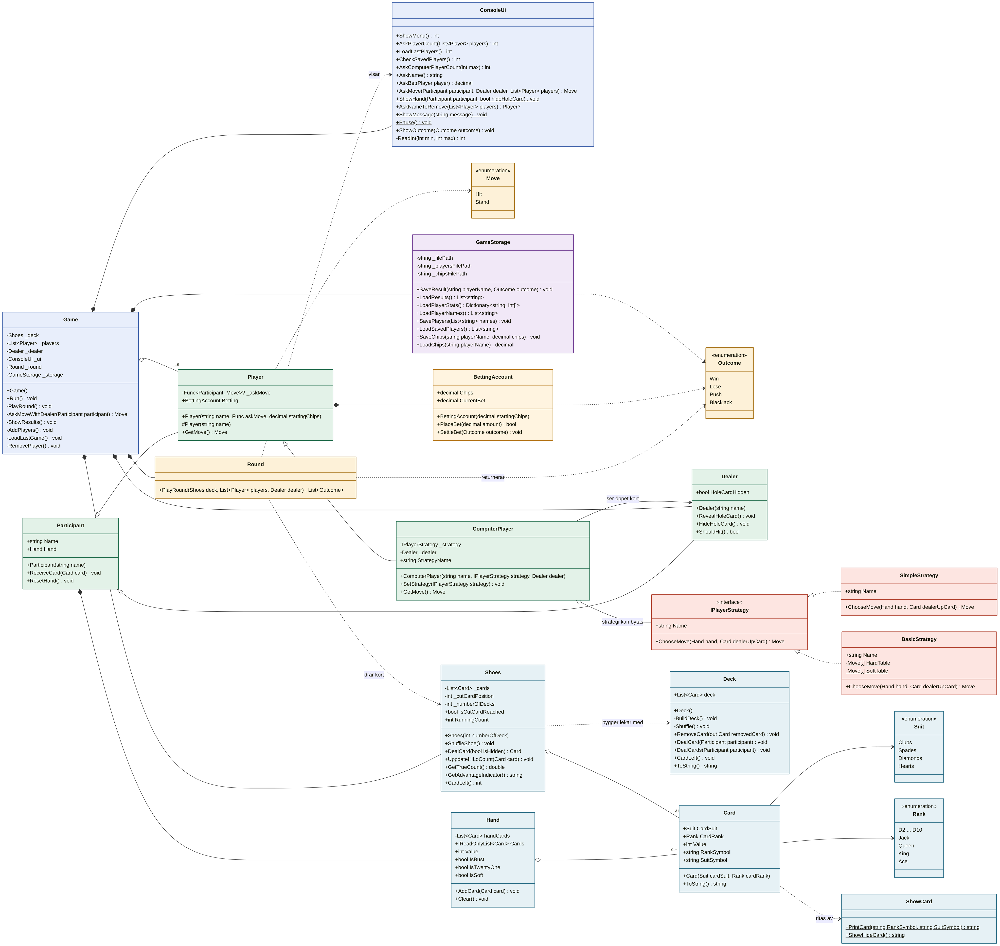

# Black jack
 
## Vad programmet gör och hur man startar det

Starta programmet från repots rot med "dotnet run --project Tjugoett".

1. **Program** skapar ett **Game** och kör Run().
2. **Game** skapar en **Shoes** (en sko med sex kortlekar som byggs och blandas direkt), en **Dealer**, **ConsoleUi**, **Round** och **GameStorage**. Sedan visas menyn via ConsoleUi (ShowMenu()) med valen Spela en runda, Ladda föregående spel, Lägga till spelare, Lämna spelet, Visa statistik och Avsluta.
3. **"Lägga till spelare"** visar först tidigare sparade spelare (LoadPlayerNames()). Game frågar efter antal spelare och namn (AskPlayerCount(), AskName()). Man kan välja en tidigare spelare eller skriva ett nytt namn, och två spelare vid bordet kan inte ha samma namn. Varje **Player** får metoden AskMoveWithDealer inskickad, som frågar ConsoleUi om spelarens drag, och ett **BettingAccount** med sina sparade marker (LoadChips()). En ny spelare börjar med 100 marker. Finns det lediga platser kvar (max 5 spelare totalt vid bordet) frågar Game hur många datorspelare man vill ha (AskComputerPlayerCount()). Varje **ComputerPlayer** får ett unikt namn, en slumpad strategi (**SimpleStrategy** eller **BasicStrategy**, som båda följer gränssnittet **IPlayerStrategy**) och givaren, så att den kan se givarens öppna kort. De mänskliga spelarnas namn sparas med SavePlayers(). **"Ladda föregående spel"** hämtar i stället samma spelare som förra gången (LoadSavedPlayers()) med deras marker, om ingen sitter vid bordet. **"Lämna spelet"** tar bort en spelare från bordet (AskNameToRemove()). Trycker man Enter utan namn avbryts valet.
4. **Inför varje runda** tas spelare utan marker bort. Varje mänsklig spelare väljer sin insats (AskBet()), medan en datorspelare automatiskt satsar 10 marker, eller det som finns kvar om den har mindre. Insatsen dras från kontot (PlaceBet()). Sedan töms allas händer och varje datorspelare får en ny slumpad strategi (SetStrategy()). Givarens andra kort döljs igen (HideHoleCard()). Har skiljekortet nåtts (IsCutCardReached) blandas skon om (ShuffleShoe()): den fylls på med sex nya kortlekar och skiljekortet läggs på en ny slumpad plats i den bakre fjärdedelen av skon.
5. **Round** delar ut två **Card** till varje spelare och givaren från skon (DealCard()). Korten hamnar i varje deltagares **Hand**. Givarens andra kort är dolt. Skon räknar varje utdelat kort enligt Hi-Lo-systemet (RunningCount), men givarens dolda kort räknas först när det vänds.
6. **Spelarnas tur:** Round anropar player.GetMove() för en spelare i taget. För en mänsklig spelare visas korträkningen (löpande och sann räkning, GetTrueCount()) och en kommentar om skon är bra eller dålig för spelaren (GetAdvantageIndicator()). Sedan visar **ConsoleUi** givarens öppna kort och alla spelares händer som kortbilder och frågar Hit eller Stand. För en datorspelare visas först dess startkort, och sedan bestämmer strategin draget (ChooseMove()) utan att någon tillfrågas. Efter en kort paus visas datorns drag. Vid Hit ger Round ett nytt kort, tills spelaren stannar, får 21 eller går över 21. Den som får 21 på de två första korten (naturlig tjugoett) hoppar över sin tur.
7. **Givarens tur:** **Dealer** vänder sitt dolda kort (RevealHoleCard()) och tar kort enligt regeln (ShouldHit()) utan att fråga någon. Givaren drar på 16 eller lägre och stannar på 17 eller högre, även mjuk 17.
8. **Resultat:** Round jämför varje spelares summa från **Hand** med givarens och ger ett **Outcome** (Win, Lose, Push, Blackjack).
9. **Tillbaka i Game:** allas händer och givarens hand visas. För varje spelare visas namnet, och för en datorspelare även vilken strategi den använde (StrategyName). Resultatet visas med ShowOutcome() och insatsen betalas ut med SettleBet(): vinst ger dubbla insatsen tillbaka, oavgjort ger insatsen tillbaka, Blackjack betalar 3:2 och förlust ger inget. Markerna sparas med SaveChips() och resultatet med SaveResult() i **GameStorage**. Spelare som har slut på marker lämnar bordet inför nästa runda. Sedan visas menyn igen, och nästa runda spelas med samma spelare.
10. **"Visa statistik"** räknar ihop varje spelares vinster, förluster och oavgjorda från sparade resultat (LoadPlayerStats()) och visar dem via ConsoleUi. **"Avsluta"** avslutar loopen i Run().

## En kort översikt över klasserna och hur de hänger ihop
Vi har utgått ifrån förslaget på klasser som fanns i uppgiftsbeskrivningen och sedan lagt till klasser för våra tillval. Namespace har använts för att göra strukturen tydligare.

Namespace *Tjugoett.UI* håller **ConsoleUi** och **Game**. ConsoleUi står för kommunikationen via Console och visar meny för användaren. Game står för att hålla igång spelet och ser till att rätt sak händer i rätt ordning. Den lägger till och tar bort spelare, tar emot insatser och startar en Round för varje omgång. Game använder sig av ConsoleUi, GameStorage och Shoes.

*Tjugoett.Cards* håller klasserna **Card**, **Deck**, **Shoes**, **ShowCard** och **Hand** samt enumarna **Rank** och **Suit**. Dessa har och hanterar data som rör korten. Deck bygger en kortlek, och Shoes lägger ihop sex kortlekar till en sko som blandas, delar ut kort, lägger skiljekortet på en slumpad plats och räknar korten enligt Hi-Lo. ShowCard ritar korten som bilder i konsolen. Hand håller en deltagares kort och räknar ut deras värde.

Namespace *Tjugoett.Participants* håller klasserna **Dealer**, **Player** och **ComputerPlayer** samt basklassen **Participant**. Dealer och Player ärver av Participant, och ComputerPlayer ärver av Player. Basklassen har namn och hand, den kan ta emot kort och tömma handen efter varje runda. Den använder sig av metoder som finns i Cards. Dealer och Player har sina respektive specifika beslut och regler som behövs för spelet. En Player har ett BettingAccount och får sitt drag från Game, medan en ComputerPlayer får sitt drag från en strategi.

Namespace *Tjugoett.Strategies* håller gränssnittet **IPlayerStrategy** och klasserna **SimpleStrategy** och **BasicStrategy** som följer det. En strategi väljer Hit eller Stand utifrån datorspelarens hand och givarens öppna kort. ComputerPlayer känner bara till gränssnittet, så strategin kan bytas mellan rundorna.

Endast **BettingAccount** är av namespace *Tjugoett.Betting*. Den håller en spelares marker och insats, drar insatsen när spelaren satsar och betalar ut efter rundan utifrån Outcome.

Namespace *Tjugoett.Rules* håller enumarna **Move** och **Outcome** samt klassen **Round**. I Move finns de två valen en spelare kan göra, Player använder sig av den. I Outcome finns de olika sätt en runda kan sluta på. Round sköter en spelrunda och använder sig av Shoes och Hand och returnerar Outcome för spelare.

Endast **GameStorage** är av namespace *Tjugoett.Storage*. Den kommunicerar med filerna där data sparas. Den sparar och laddar resultat, spelarnas marker och vilka spelare som var med senast och räknar ihop statistik per spelare.

 
## Vem som gjort vad — vilket tillval var och en har byggt
### Aldo
- Enum Move
- Enum Outcome
- Klassen Round
- **Tillval 5 - Sko med flera lekar och korträkning** 

### Aythami
- Enum Suit
- Enum Rank
- Klassen Card
- Klassen Deck
- klassen Game
- **Tillval 1 - Kortgrafik i konsolen**

### Emelianna
- Klassen Participant
- Klassen Player
- Klassen ConsoleUi tillsammans med Danial
- Program.cs
- **Tillval 2 – Datorspelare med strategi**

### Danial

- Klassen Hand
- Klassen Dealer
- Klassen GameStorage
- Klassen ConsoleUi tillsammans med Emelianna
- **Tillval 4 - Satsningar och marker**

## Vilka regler som gäller, om ni avvikit från specifikationen på någon punkt
- Det måste alltid finnas minst en mänsklig spelare, och högst fem spelare vid bordet.
- "Ladda föregående spel" kan bara användas innan några spelare har lagts till vid bordet.
- Nya spelare börjar med 100 marker. Den som får slut på marker lämnar bordet inför nästa runda.
- En spelare som har fått slut på marker får automatiskt 100 nya marker nästa gång hen är med, ungefär som att köpa in sig igen. Laddar man föregående spel kommer alla spelare från förra gången tillbaka, och de som hade 0 marker börjar om med 100.
- Datorspelare börjar alltid med 100 marker och satsar 10 marker varje runda. Deras marker sparas inte mellan spelen.
- En spelare känns igen på sitt namn. Samma namn i ett senare spel får samma marker och statistik.
- Det spelas med en sko med sex kortlekar. Skiljekortet läggs på en slumpad plats i den bakre fjärdedelen av skon, och när det nås blandas skon om efter rundan.

## Kända brister
- En spelare som har valt "Lämna spelet" kommer ändå tillbaka om man väljer "Ladda föregående spel" nästa gång.

## Klassdiagram

